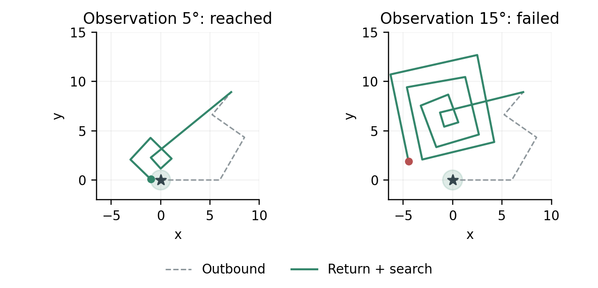

# 果蝇连接组的方向编码与读出及归巢验证

这是一份小规模课程实验，核心问题是：人为编码的方向经过 FlyWire v783 中央复合体连接组后，能否从下游神经元的放电中读出来。果蝇网络的连接和权重固定，只训练外部岭回归读出器，学习“放电特征到输入方向”的对应关系。归巢是应用验证，位置记忆、路径积分、返程与有限搜索均由外部程序完成。

**研究重点是方向读出的训练与检验。5 页论文已展开输入编码、放电特征、回归训练和误差分析，并配套静态图表与可复现源码。**

## 查看最终成果

- [最终论文](reports/果蝇连接组方向读出与归巢验证_24025110_尹一清.docx)：沿用指定参考报告排版，解释方向编码公式、48 个训练样本、正弦余弦读出和归巢误差；正文汇总两张结果表，完整置换明细及轨迹图作为补充材料。
- [论文轨迹图 PNG](reports/assets/paper_trajectory.png)、[矢量 PDF](reports/assets/paper_trajectory.pdf)：蓝色出发、橙色返程、紫色搜索，标明起点与阶段切换位置。[图注与插图说明](docs/paper_figures.md)。
- [成果包说明](docs/final_delivery.md)：目录结构、查看方式和复现步骤。

在 Git 仓库中运行下面的命令，将当前提交导出为独立成果包。仅需 Python 标准库和 Git；目录必须不存在，未提交的文件不会进入成果包。

```bash
python scripts/package_delivery.py --output ../最终成果
```

先阅读成果包 `01_论文` 中的摘要、方法和表一，了解谁在学习以及学到了什么；再看 `02_论文插图` 中的方向对照与分阶段归巢图。静态图同时提供 PNG 与 PDF，可直接用于论文。`04_完整项目` 含该提交的源码、配置、依赖清单和各阶段结果；大型公开数据由脚本重新下载，环境与 Git 历史不重复打包。

## 最新验证

48 个标定样本用于训练外部读出器，16 个未见方向的平均角误差为 4.24°，五组训练方向标签打乱后为 65.29°–111.94°。该误差衡量对输入方向的恢复精度。标签对照说明正确的方向对应关系对读出有效；连接结构的作用可通过后续随机连接组对照进一步分析。

下面的归巢结果用于应用验证。观测噪声模拟运动感知偏差，搜索预算控制估计起点附近可用于搜索的额外路程。

三条路线 × 十个新种子，每档噪声 30 个组合；搜索预算固定为 72，成功半径为 1。

| 外出转向观测噪声 | 神经归巢：理想返程 | 神经归巢：2° 返程转向误差 |
| --- | ---: | ---: |
| 0° | 30/30 | 30/30 |
| 5° | 30/30 | 30/30 |
| 15° | 21/30 | 20/30 |

标签打乱后，旧低噪声试验中的到达次数由 15/15 降至 3/15–13/15，平均返程路程增加，说明方向读出会影响后续行为；搜索也能补救一部分错误。新种子的几何基线效果与神经方法接近。

预算验证也保留了不符合原先预想的结果：旧样本中预算 36 足以覆盖低噪声成功，新样本中只能到达 27/30（理想返程）或 28/30（有执行误差）；因此主配置继续保留 72。

- [项目总览](docs/project_overview.md)：方法分工、实验链条和结题剩余事项。
- [本轮结果说明](docs/validation_results.md)、[运行前固定的方案](docs/validation_plan.md)。
- [神经方向信息对照](examples/validation-20261104/figure1_neural_controls.png)、[返程误差验证](examples/validation-20261104/figure2_return_robustness.png)、[搜索预算曲线](examples/validation-20261104/figure3_budget_tradeoff.png)。
- [逐次返程结果](examples/validation-20261104/robustness_metrics.csv)、[全部标签置换对照](examples/validation-20261104/ablation_by_variant.csv)。

下面的论文图使用预先固定的原路线、种子 701 和 2° 返程转向误差。A 是家，沿蓝虚线外出到 B 后开始返程，橙线到 C 后开始紫色搜索。箭头表示运动方向，环境无障碍物。



[旧版动画](examples/validation-20261104/homing_demo.gif)保留为补充材料。

## 此前阶段：实际到达起点区域

先沿神经读出估计的方向返程；尚未到达时，在估计起点附近执行扩展方形搜索，附加路程最多 72。进入起点半径 1 的区域时停止。**到达信号是新增的任务假设，只用于停止，不提供目标方向、距离或坐标；搜索由外部程序实现。**

三条路线 × 五个此前未使用的种子，每档噪声共 15 次。两种方法使用相同的初始返程指令和途中到达判定。

| 单步转向噪声 | 神经直接返程到达次数 | 神经返程加搜索到达次数 | 平均返程路程：直接 / 搜索 |
| --- | ---: | ---: | ---: |
| 0° | 15/15 | 15/15 | 8.61 / 8.61 |
| 5° | 3/15 | 15/15 | 8.78 / 15.06 |
| 15° | 1/15 | 10/15 | 7.72 / 48.89 |

路程均值包括失败试验；距离单位沿用原实验。5° 条件下，三条路线分别达到 5/5。15° 下仍有 5 次在搜索预算耗尽后失败。几何积分加相同搜索的结果是 15/15、15/15、9/15，因此改进主要来自搜索策略，不能据此声称神经方法优于几何方法。

- [轨迹图](examples/search-20261104/figure1_search_trajectories.png)：预先固定的原路线、种子 601，展示直接返程与搜索。
- [到达率与路程](examples/search-20261104/figure2_search_results.png)：同时展示收益和额外行走代价。
- [完整结果](examples/search-20261104/summary.csv)、[分路线结果](examples/search-20261104/by_route.csv)、[实验说明](docs/search_homing_results.md)。
- [预定方案](docs/search_homing_plan.md)保留运行前固定的路线、种子、搜索参数和目标。

## 此前：神经方向读出改进

- `examples/motion-average-20261104/figure1_trajectories.png`：第一枚预定种子下的三方法外出与返程轨迹。
- `examples/motion-average-20261104/figure2_errors.png`：三档噪声的归巢误差和独立方向读出检验。
- `examples/motion-average-20261104/summary.csv`：汇总结果；`metrics.csv` 保留每次试验。
- `reports/数字果蝇归巢改进实验报告_排版版.docx`：按指定的多元时序预测实验报告排版，加入方向读出的因果时间平均及其复核结果。
- `reports/数字果蝇归巢课程报告.docx`：保留的原始 3 页报告。
- `examples/motion-average-20261104/` 和 `examples/motion-confirm-20261104/`：原有三个种子和三个新种子的改进结果，含逐次数据、轨迹图和复跑记录。
- `examples/window-comparison-20261104/`：250 ms 与 1,000 ms 神经观察窗口的配对结果；延长窗口没有稳定提升归巢成功率。

该阶段报告沿用参考文件的 A4 页边距、宋体字号、姓名学号布局、图表说明和表格样式。格式脚本另存输出，不覆盖原报告和参考文件。验证记录见 `data/metadata/improvement_validation.json`。

原始 CX 读出在无噪声条件下平均误差为 2.04，成功 1/3。沿观测转向对神经方向读数作因果圆周平均后，原有种子的无噪声误差为 0.19，成功 3/3；另三个新种子也为 3/3。有观测噪声时没有稳定改善。

| 单步转向噪声标准差 | 几何方法误差 | CX 原始读出误差 | CX 运动补偿平均误差 |
| --- | ---: | ---: | ---: |
| 0° | 0.00 ± 0.00 | 2.04 ± 1.54 | 0.19 ± 0.08 |
| 5° | 2.82 ± 1.89 | 2.39 ± 1.40 | 2.92 ± 1.90 |
| 15° | 8.30 ± 5.65 | 6.88 ± 5.60 | 8.26 ± 5.63 |

表中是原有三个种子的均值 ± 样本标准差，距离用任意单位，成功阈值为 1。独立新种子复核的 0° 平均误差为 0.35、成功 3/3；5° 和 15° 都是 0/3。结果只支持本条路线下的无噪声改进。

## 在当前服务器运行

项目位于 `/home/jiutian/projects/fly-brain-navigation`。已有 `.venv-sim`、公开模型及数据，不需要重复安装或下载。

```bash
cd /home/jiutian/projects/fly-brain-navigation
.venv-sim/bin/python -m unittest discover -s tests -v
.venv-sim/bin/python scripts/run_validation_suite.py --config configs/homing_validation.json --output outputs/my-validation
.venv-sim/bin/python scripts/run_validation_suite.py --verify outputs/my-validation
.venv-sim/bin/python scripts/plot_validation.py outputs/my-validation --animation
```

输出目录必须不存在，避免覆盖结果。省略 `--output` 会自动使用时间戳。主脚本顺序运行三条新种子路线，并使用仓库内保留的旧结果计算标签对照和历史预算；绘图脚本生成三张图和可选动画。`--verify` 根据保存的神经数据重算控制器结果，不重复运行 Brian2。

仓库中的最新样例也可直接核对：`scripts/run_validation_suite.py --verify examples/validation-20261104`。这个核对包含生成时的源码哈希，源码变更后的历史记录应在对应 Git 提交下验证。此前的搜索实验可用 `scripts/run_search_homing.py --replay examples/search-20261104` 重放。

此前的单路线实验仍可使用 `scripts/run_homing.py --config configs/homing_motion_average.json --output outputs/my-run` 运行，再通过 `scripts/plot_homing.py outputs/my-run` 出图。

本次原始实验位于 `outputs/homing/coursework-20261103/`。同一环境另起进程重复运行后，指标、轨迹、观测、标定数据和神经计数完全一致，证据在 `reproducibility.json`。

## 在新的 Linux 机器重建

需要 Python 3.10、Git、curl 和 C/C++ 编译器。脚本使用 Linux 的内存信息和进程资源上限；本地 Mac 上的副本主要用于查看代码、结果和报告，仿真在服务器运行。

```bash
python3.10 -m venv .venv-sim
.venv-sim/bin/python -m pip install -r requirements-sim.lock.txt
.venv-sim/bin/python scripts/setup_upstream.py
.venv-sim/bin/python scripts/download_data.py
.venv-sim/bin/python -m unittest discover -s tests -v
.venv-sim/bin/python scripts/run_validation_suite.py --config configs/homing_validation.json --output outputs/first-run
.venv-sim/bin/python scripts/run_validation_suite.py --verify outputs/first-run
.venv-sim/bin/python scripts/plot_validation.py outputs/first-run --animation
```

数据脚本校验大小和上游 MD5/Git blob 哈希，支持已有文件检查和断点续传。原始数据及依赖不放入代码仓库。下载来源见 `data/sources.json`、`docs/data_sources.md`；模型版本见 `upstream.lock.json`。

## 实验怎样工作

1. 读取注释为 CX 的 2,869 个神经元，保留其内部 300,065 条连接记录，沿用作者的带符号权重与 LIF 参数。
2. 按原版行序给 47 个 EPG 神经元分配人工方向相位，用 15–150 Hz 的 Poisson 输入编码方向。相位没有解剖学含义。
3. 按结构连接强度选取 128 个非 EPG 下游神经元，以 250 ms 窗口内的放电次数作为特征。用 48 个标定样本拟合一个岭回归读出；16 个未见方向的平均误差为 4.24°。
4. 外部程序累积带噪声的转向观测，把得到的方向送入神经网络，再按神经读出的方向和精确距离累积位置。每个神经窗口从静息状态开始，因此神经网络本身不承担跨步记忆。
5. 改进版把历史神经方向读数沿观测转向旋转到当前时刻，作圆周平均后用于位置积分和返程转角。该递推仅用当前与过去观测，不含真实方向、真实位置或未来观测，细节见 `docs/motion_average_plan.md`。
6. 根据估计位置和最后方向计算一次转向与返程距离；环境执行该指令。初版采用理想返程，最新验证加入 0°/2° 转向执行误差；行走距离仍准确，没有障碍物或碰撞。
7. 最新版本在未触发到达信号时执行固定参数的有限搜索；直接返程与搜索均在首次进入目标区域时终止。控制器不接收真实位置或目标方位。这个新增的二值到达信号在实际系统中需要接触或局部识别来实现。

该设置检验神经读出能否参与一个可复现的导航流程。它不能证明原生的方向保持、路径积分机制或相对其他网络的优越性。完整方法与边界见报告和 `docs/experiment_plan.md`。

## 实际开销与检查

- 单进程 CPU/Cython 仿真；没有使用 4090 GPU。
- 最新 90 个神经导航试验与控制器分析约 106.77 秒，不含出图，单个神经进程峰值 RSS 约 611.72 MiB；三条路线顺序执行。编译、缓存和机器负载会影响耗时。
- 启动时检查至少 3 GiB 可用主存，当前试验进程限制为 2 GiB 虚拟地址空间。
- 二十项单元检查覆盖几何与神经读出、目标接触、统一终止规则、搜索预算、标签置换和执行误差配对。最新 10 张结果表通过独立进程控制器重放核对，包含 720 行方向对照和 1,440 行返程验证。
- GitHub Actions 配置自动运行轻量单元检查、旧结果导航重放与最新十张验证表核对；该流程无需下载连接组数据，不执行完整 Brian2 神经仿真。
- 断开 CX 连接后，非输入读出神经元的放电计数为 0。5° 噪声下另做读出关闭对照。以上检查不证明该连接组优于随机连接。

## 文件

- `configs/homing_validation.json`、`scripts/run_validation_suite.py`：方向标签对照、新种子、返程执行误差、预算分析和结果核对。
- `scripts/plot_validation.py`：三张验证图与固定种子演示动画。
- `examples/validation-20261104/`：最新全部结果和演示；`docs/validation_results.md` 解释结果与限制。
- `configs/homing_search.json`、`scripts/run_search_homing.py`：三路线神经试验、有限搜索、公平对照、出图与导航重放。
- `examples/search-20261104/`：首轮搜索验证的逐次结果、轨迹、图表和神经输出；不包含可重新生成的连接组数据副本。
- `configs/homing.json`、`configs/homing_motion_average.json`、`configs/homing_motion_confirm.json`：基线及改进试验配置。
- `scripts/run_homing.py`：神经标定、运动观测、归巢和统计。
- `scripts/plot_homing.py`：从 CSV/NPZ 生成两张图。
- `scripts/compare_windows.py`：核对长窗口试验两组随机种子、共用运动观测和几何结果。
- `scripts/build_improved_report.py`：从两组已保存结果生成改进报告，原始报告生成脚本 `build_report.py` 保留。
- `scripts/smoke_simulation.py`：此前的 CX/全脑短时验证和子图提取。
- `scripts/setup_upstream.py`、`scripts/download_data.py`：依赖源码和数据准备。
- `examples/coursework-20261103/`：小型结果样例，纳入版本管理。
- `docs/`：数据来源、环境验证、实验范围和结果说明。

代码版本管理包括源文件、配置、依赖、示例结果和阶段报告；`.gitignore` 已排除环境、原始大数据、外部仓库和临时输出。

## 版本维护

GitHub 仓库：[yinyiqing/fly-brain-navigation](https://github.com/yinyiqing/fly-brain-navigation)，主分支为 `main`。

每完成一项完整改动，先做相关检查，再提交并推送。提交信息按改动类型使用中文描述，例如 `add：加入路径分析模块`、`fix：修复归巢误差计算`、`update：更新实验配置与结果说明`。协作约定见 `AGENTS.md`。

## 来源

FlyWire v783 数据与注释、Shiu 等的公开模型均保留版本和出处。文献条目见 `references.bib`。上游模型采用 MIT 许可；数据按各自来源许可使用。

## 更新报告

安装 `requirements-report.txt` 后，从保存的实验结果和论文插图生成最终论文：

```bash
python scripts/build_final_report.py --reference /path/to/参考报告.docx
```

输出为 `reports/果蝇连接组方向读出与归巢验证_24025110_尹一清.docx`，不会修改原始参考或此前报告。论文图由 `scripts/plot_paper_trajectory.py` 绘制，已保存在 `reports/assets/`，含 PNG 和矢量 PDF；重画需要 matplotlib、NumPy、pandas 和中文字体（如 Noto Sans CJK）。修改后应重新检查分页，当前版本按任务书要求渲染核对为 5 页。

此前的阶段报告仍可单独生成；依赖对应两组实验结果和图表：

```bash
python scripts/build_improved_report.py
python scripts/format_report.py --reference /path/to/参考报告.docx --source reports/数字果蝇归巢改进实验报告.docx --output reports/数字果蝇归巢改进实验报告_排版版.docx
```
